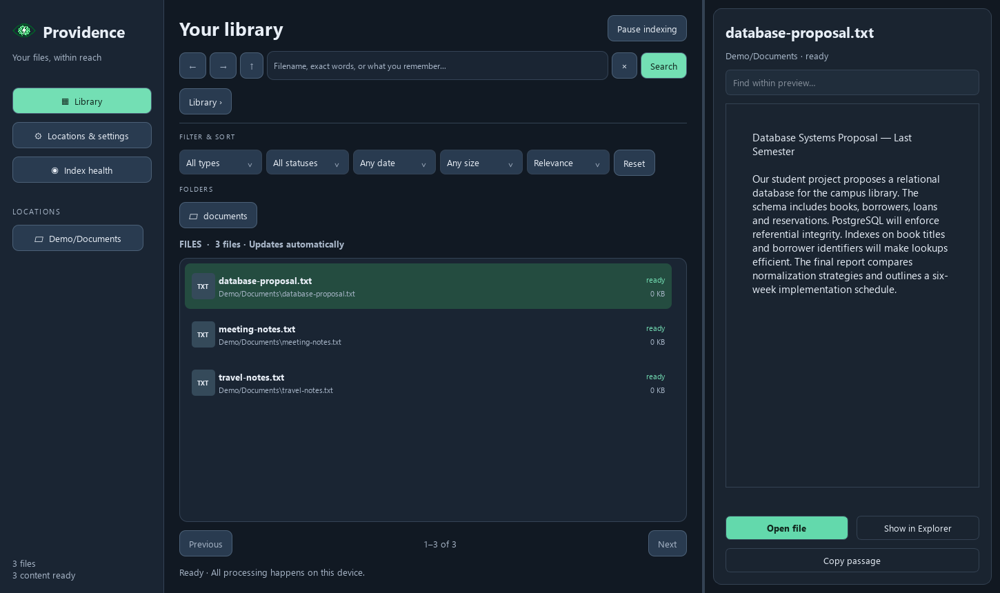
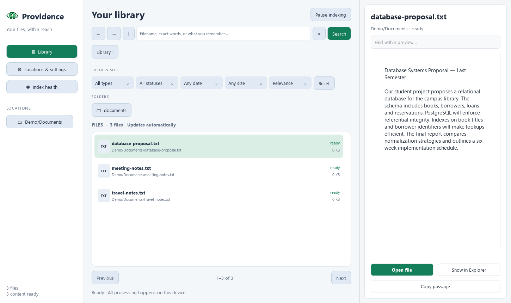
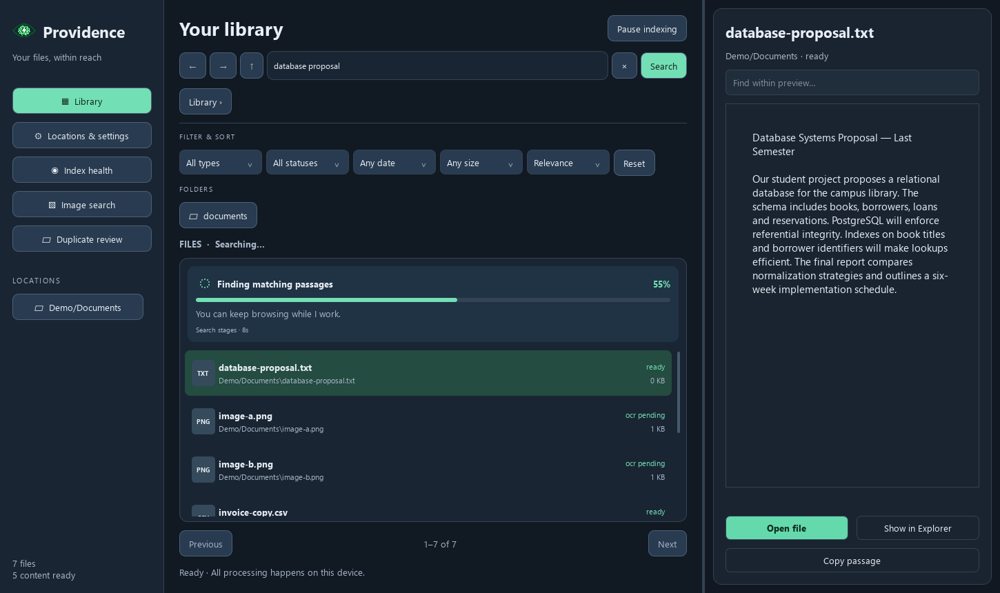
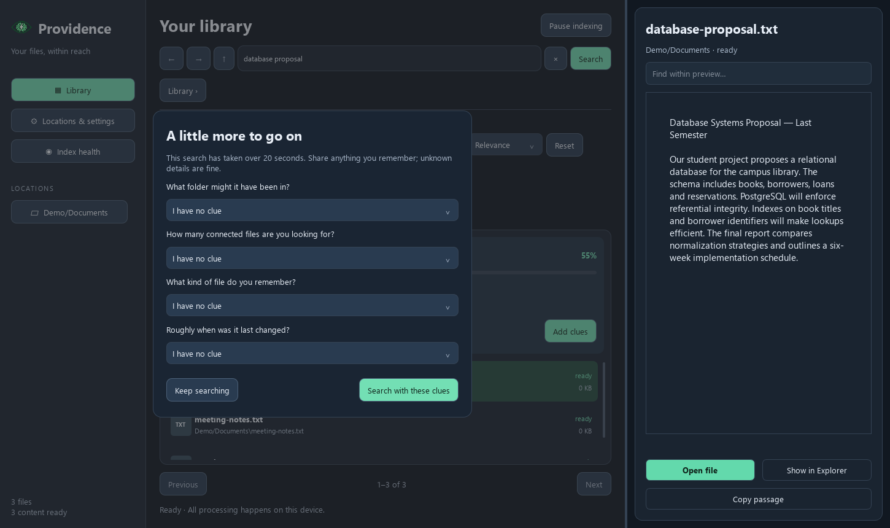

<p align="center">
  
</p>

# Providence

**Find your files by what you remember.** Providence is an offline desktop file browser and search app. It combines filenames, exact text, and semantic search to find documents, scanned PDFs, and screenshots on your computer.

**Version 1.0.1 · Windows desktop · MIT license**



## What you can do

- **Keep a library current automatically.** Choose folders or readable local drives once. New, changed, moved, and deleted files update while Providence is open.
- **Search on your terms.** Press Enter or click Search to begin. Typing and changing filters never launch AI search.
- **Search document text and scans.** Offline OCR makes printed text in scanned PDFs and PNG/JPEG images searchable.
- **Browse while indexing.** Filenames appear before content processing finishes. Filter by location, extension, status, size, and modified date.
- **Preview matches.** Read documents, jump to PDF pages, find text, and view OCR highlights before opening the original file.
- **Add clues when a search takes longer.** An unfinished search over 20 seconds offers optional folder, result-count, file-type, and date clues.
- **Make the interface comfortable.** Light, dark, and system themes, reduced motion, keyboard shortcuts, resizable panes, and low-resource mode are available.
- **Inspect indexing health.** Check processing states, readable errors, and retry controls in Index health.

<details>
<summary>More demo screenshots</summary>

### Light theme



### Search progress



### Optional search clues



</details>

Screenshots use fictional documents and demo paths. The progress and clues screens are staged demonstrations of the interface, not search-latency measurements.

## Get started

### Windows portable app

Published packages are listed on the [Releases page](https://github.com/Totenem/Providence/releases). For a Windows portable package:

1. Extract the entire ZIP. Keep `Providence.exe` and its `_internal` folder together.
2. Open `Providence.exe`. Python and Docker are not required for the portable app.
3. Review the locations Providence can access, or choose a specific folder, then select **Start my library**.
4. Browse files as they appear. Enter a filename, phrase, or description and press **Enter** or **Search**.

For example: `the database proposal from last semester`.

Use **Locations & settings** to change scope, exclusions, theme, OCR, resource mode, or the search model. Use **Index health** to review files needing attention. Processing stops when the app closes and unfinished indexing resumes on the next launch.

The desktop target is 64-bit Windows. Inference runs on the CPU; a dedicated GPU is not required. Qwen uses substantially more memory than MiniLM, so MiniLM is the lighter option. The portable app currently has no installer, tray mode, or launch-at-login feature.

### Supported content

| File type | Search and preview support |
|---|---|
| PDF | Native text, scanned-page OCR, page previews, and match highlights |
| Word (`.docx`) | Extracted text and formatted preview |
| Text and Markdown | Text search, reading, and find-in-preview |
| PNG and JPEG | OCR text search and image previews with recognized regions |
| Other readable files | Filename/path search and metadata browsing; content extraction is not supported |

Search progress describes completed stages, not confidence that a match is correct. All optional clues default to **I have no clue**. Folder/type/date clues narrow retrieval; the connected-file count limits how many matches are returned. Select **Search with these clues** to submit a refinement.

### Privacy and practical limits

Models and OCR run locally after setup. The running app does not download models. Source installation and Docker image creation require internet access to obtain dependencies and pinned model assets.

Only selected, readable locations are indexed. Default exclusions skip system/application folders, caches, dependency folders, reparse points, and cloud placeholders. Docker can see only mounted folders.

The local index stores extracted text and is **not encrypted**. The clear-index control removes library indexes and OCR caches while preserving original files. By default, app data lives in `~/.providence`; `PROVIDENCE_DATA_DIR` can override that location.

Content processing is limited to 50 MB per file, 500 pages per PDF, and a 90-second OCR timeout per document. Larger or unreadable files can remain discoverable by filename. Password-protected files require their original application. Handwriting, complex photographs, and faithful table reconstruction are not validated OCR use cases. Cold model loading and rebuilding a changed vector index can make the first search slower.

## Run from source

Python **3.11–3.13** is supported; Python 3.13 is used for Windows validation. From the repository root in PowerShell:

```powershell
py -3.13 -m venv .venv
.\.venv\Scripts\python.exe -m pip install --upgrade pip
.\.venv\Scripts\python.exe -m pip install torch --index-url https://download.pytorch.org/whl/cpu
.\.venv\Scripts\python.exe -m pip install -e ".[dev]"
.\.venv\Scripts\python.exe docker/download_model.py --destination build/model
$env:PROVIDENCE_MODEL_DIR = "$PWD/build/model"
.\.venv\Scripts\python.exe -m providence
```

To make the stronger Qwen embedding model available, download its pinned assets before launching:

```powershell
.\.venv\Scripts\python.exe scripts/download-qwen.py --destination build/qwen
```

New libraries default to Qwen when its assets are present. Existing MiniLM libraries keep their model until changed in settings. Switching builds a separate compatible index before activation and retains the previous index.

The source CLI also supports indexing and search:

```powershell
.\.venv\Scripts\python.exe -m providence index ./demo-documents
.\.venv\Scripts\python.exe -m providence search "database proposal" --limit 10
```

### Browser preview with Docker

With Docker Desktop using Linux containers:

```powershell
docker compose up -d --build
```

Open [the localhost desktop preview](http://localhost:6080/vnc.html?autoconnect=1&resize=remote). Demo documents are mounted at `/documents` by default. Set `PROVIDENCE_DOCUMENTS` in `.env` to mount a different host folder and recreate the containers. The document mount is read-only; app data is kept in a named volume.

The browser displays the desktop application through noVNC. It is not a separate web interface. Device-wide discovery is available in the native desktop app; containers cannot inspect unmounted host files.

## Contribute

Bug reports, usability feedback, extraction improvements, and reproducible retrieval evaluations are welcome through [Issues](https://github.com/Totenem/Providence/issues) and pull requests. For a bug report, include the OS, selected model, file type, expected behavior, and observed behavior. Use fictional or anonymized samples rather than private documents.

The main library UI uses **Qt Quick/QML**. Native Qt widgets provide rich document previews and settings/health dialogs. The backend uses **SQLite/FTS5**, a cached **USearch HNSW** vector index, **Watchdog** filesystem notifications, and **RapidOCR/ONNX Runtime**.

Run the source tests before submitting changes:

```powershell
$env:PROVIDENCE_MODEL_DIR = "$PWD/build/model"
$env:QT_QPA_PLATFORM = "offscreen"
$env:QT_QUICK_BACKEND = "software"
New-Item -ItemType Directory -Force .artifacts | Out-Null
.\.venv\Scripts\python.exe -m pytest -q --basetemp .artifacts/test-run
```

Remove `QT_QPA_PLATFORM` and `QT_QUICK_BACKEND` from the environment before returning to a normal desktop session. For UI changes, inspect light/dark and smaller-window layouts. [The screenshot helper](scripts/preview-ui.py) can render public demo paths with `--public`. Retrieval changes should include benchmark results and explain any accuracy, latency, or memory tradeoffs.

For Windows packaging, see [the build script](scripts/build-windows.ps1), [pinned build dependencies](requirements-windows.txt), and [portable package instructions](scripts/WINDOWS-README.txt). The app and its bundled dependencies/models must remain together.

Every release includes a [user-facing summary](docs/releases/1.0.1.md) and GitHub-generated change notes. See [the release process](docs/RELEASING.md) for versioning, validation, and the separate build/publication controls.

## Research and evaluation

Providence fuses filename/path matches, FTS5 keyword results, and semantic candidates. It ships [Qwen3-Embedding-0.6B](https://huggingface.co/Qwen/Qwen3-Embedding-0.6B) and [all-MiniLM-L6-v2](https://huggingface.co/sentence-transformers/all-MiniLM-L6-v2) as embedding options. OCR uses RapidOCR 3.10.0 with PP-OCRv6 small ONNX assets. Search clues guide retrieval; they do not load a conversational LLM.

The local evaluation uses **25 fictional files and 200 queries**, covering English, Filipino, mixed language, identifiers, and filenames:

| Metric | MiniLM | Qwen3-Embedding-0.6B |
|---|---:|---:|
| Recall@1 | 86.5% | 92.5% |
| Recall@5 | 91.5% | 96.5% |
| nDCG@10 | 0.9022 | 0.9512 |
| Filipino-only Recall@5 | 66% | 86% |

These are **synthetic smoke-test results**, not independent benchmarks or guaranteed accuracy. Queries were created alongside the files, every query has a relevant answer, and no-match detection is not calibrated. Filename/identifier cases also exercise exact matching, so the figures do not isolate embedding quality. Hardware tiers and representative large-library performance remain unvalidated.

See [evaluation methods, timing results, and limitations](docs/1.0.1-validation.md), plus the raw [MiniLM](docs/benchmarks/minilm.json) and [Qwen](docs/benchmarks/qwen.json) results.

Reproduce the retrieval and vector-scale checks after source/model setup:

```powershell
.\.venv\Scripts\python.exe scripts/benchmark-search.py --profile minilm --output .artifacts/benchmark/minilm.json
.\.venv\Scripts\python.exe scripts/benchmark-search.py --profile qwen --output .artifacts/benchmark/qwen.json
.\.venv\Scripts\python.exe scripts/benchmark-vectors.py
```

The vector-scale check uses 10,000 artificial single-passage files and excludes model encoding, discovery, and document extraction. It does not measure full device-indexing speed.

## License

Providence is licensed under [MIT](LICENSE). Bundled libraries and model weights retain their respective licenses; portable packages include third-party notices and model cards.
